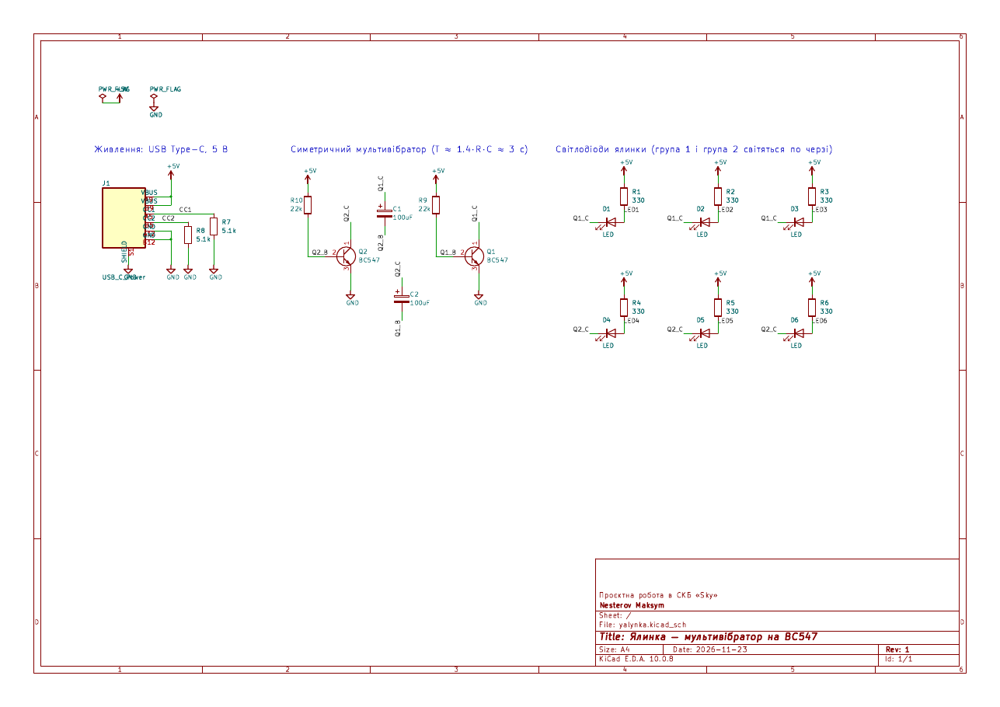
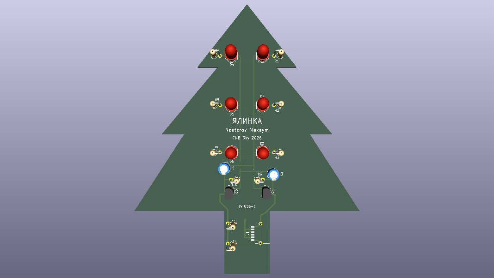

# Ялинка — мультивібратор на BC547

**Автор:** Nesterov Maksym
**Курс:** Проєктна робота в СКБ «Sky» (осінь 2026)

Плата у формі ялинки: дві групи світлодіодів (по 3 шт.) блимають по черзі.
Схема: симетричний мультивібратор на двох транзисторах BC547, живлення 5 В від USB Type‑C.
Проєкт виконано в **KiCad 10**.

## Схема електрична принципова

Векторна версія: [schematic.svg](schematic.svg) · PDF: [schematic.pdf](schematic.pdf)

## Плата (3D)

## Як працює

- Q1, Q2 (BC547) по черзі відкриваються й закриваються. Час перемикання задають R9/R10 (22 кОм) і C1/C2 (100 мкФ), період ≈ 1.4·R·C ≈ 3 с.
- D1–D3 (через R1–R3, 330 Ом) світяться, коли відкритий Q1; D4–D6 (через R4–R6), коли відкритий Q2.
- J1 — USB Type‑C (тільки живлення), R7/R8 по 5.1 кОм на CC1/CC2, щоб зарядник видавав 5 В.

## Перелік елементів

| Позначення | Елемент | Кількість |
|---|---|---|
| Q1, Q2 | BC547 (TO‑92) | 2 |
| D1–D6 | LED 5 мм | 6 |
| R1–R6 | 330 Ом | 6 |
| R9, R10 | 22 кОм | 2 |
| R7, R8 | 5.1 кОм | 2 |
| C1, C2 | 100 мкФ, електролітичний | 2 |
| J1 | USB Type‑C, 6 pin (power only) | 1 |

## Файли

| Файл | Що це |
|---|---|
| `yalynka.kicad_pro` | проєкт KiCad |
| `yalynka.kicad_sch` | схема |
| `yalynka.kicad_pcb` | плата (100 × 120 мм, 2 шари) |
| `Yalynka.pretty/` | посадкове місце роз'єму USB‑C |
| `yalynka.step` | 3D-модель плати (для Fusion 360 / FreeCAD) |
| `yalynka_stand.stl` | підставка під плату (паз під «стовбур» ялинки) |
